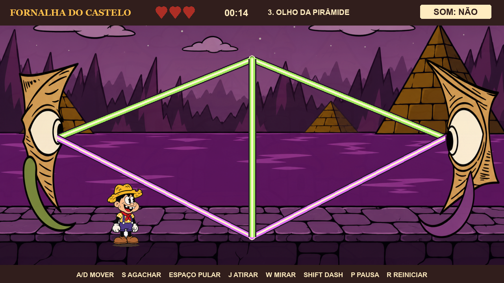

# A Fornalha do Castelo — versão próxima da aula

Jogo de ação lateral em **Python + Pygame**, inspirado em **Cuphead**. O protagonista mineiro enfrenta três chefes, com duas formas cada: Dragão Vermelho, Chefe Comilão e Olho da Pirâmide. As três fases, a introdução, a passagem entre cenários e o encerramento estão implementados.

**Integrantes:** Davi, Moisés e João Marcelo.  
**Repositório:** [Cuphead-Mineirinho-2](https://github.com/barrosojoaomarcelo-coder/Cuphead-Mineirinho-2).

**[DIVISÃO DA EQUIPE: tarefas, arquivos e branches](DIVISAO_DA_EQUIPE.md)**

## Versão difícil e animações

A fase 1 incorpora o perfil HARD_ATTACKS de A_Fornalha_do_Castelo_Boss_Dificil.zip: dez famílias de ataques, fileiras horizontais baixas/altas, até duas bolas gigantes e ondas adicionais. Os 40 parâmetros de cada um dos quatro níveis foram mantidos em dicionários de boss_attacks.py. Os três chefes agora exigem 800 acertos para compensar a cadência de 20 tiros/s e recuperar a duração da versão difícil anterior, que exigia 480 acertos a 12 tiros/s. As três vidas e os controles do jogador foram preservados.

O Comilão também tem 800 pontos de vida, intervalos menores, até cinco raios, combos de língua com aviso individual e até três ondas de espinhos com faixa segura. As duas formas têm 12 poses novas: respiração, piscada, preparação, disparo e recuperação. O personagem e o dragão usam compressão/alongamento visual, com rastros de dash, estrelas de impacto e nuvem na transformação. São recursos inspirados em animação cartunesca dos anos 1930, sem usar sprites oficiais de Cuphead.

Use S ou seta para baixo para agachar nas fileiras horizontais altas; pule as baixas. O recorde do perfil anterior é separado do novo, preservando a preferência de som. Consulte [os detalhes do balanceamento](docs/DIFICULDADE_E_ANIMACAO.md).

## Fase 3 — Olho da Pirâmide

A luta acontece nas ruínas de um lago roxo, conforme as referências do grupo. Na primeira forma, a pirâmide invoca serpentes e morcegos de um olho e dispara anéis de energia baixos, altos e alternados. As criaturas podem ser destruídas pelos tiros.

Ao perder metade da vida, o chefe se divide em dois olhos nas laterais. Eles compartilham a mesma vida e usam lasers horizontais, cruzados, em losango, com reflexo no chão e com mira fixada antes do disparo. Os caminhos aparecem antes dos raios; as faixas verdes indicam espaço seguro para o jogador em pé.

O jogo tem **três vidas por fase, 20 tiros por segundo a 1800 pixels/s e nenhuma barra de vida dos chefes**. A evolução aparece nas formas e nos padrões. As regras de ataques difíceis do dragão e do Comilão continuam presentes. O novo ritmo de tiro tem recorde separado do anterior.

O ajuste de dificuldade mantém aproximadamente 40 segundos de acertos contínuos, além de transformação e deslocamento dos tiros: cerca de 44–45 segundos nas medições de fluxo. Errar tiros ou parar para esquivar aumenta esse tempo. O recorde da edição com chefes de 480 pontos é separado deste perfil. Para atualizar uma cópia já baixada, veja [COMO_ATUALIZAR_DIFICULDADE.md](COMO_ATUALIZAR_DIFICULDADE.md).

[Guia para integrar a fase 3 à versão anterior](COMO_INTEGRAR_FASE_3.md) · [Artes e prompts](docs/ARTES_PIRAMIDE.md)

## Como executar

Use **Python 3.12**, versão usada nos testes locais. Extraia o ZIP inteiro e abra o terminal na pasta que contém main.py:

~~~sh
python -m pip install -r requirements.txt
python main.py
~~~

No Windows, também é possível abrir **INICIAR_WINDOWS.bat**. O iniciador cria .venv e instala o Pygame. É necessário ter Python instalado e internet na primeira instalação. Se o comando do seu computador for python3, substitua python por python3.

## Controles

| Ação | Teclas |
| --- | --- |
| Mover | A / D ou setas |
| Pular | Espaço ou Z; segure para um salto mais alto |
| Atirar | J ou X; pode segurar |
| Mirar para cima | W ou seta para cima |
| Mirar na diagonal | Combine a mira para cima com A / D |
| Agachar | S ou seta para baixo |
| Dash / esquiva | Shift ou K |
| Pausa / continuar | P ou Esc |
| Reiniciar a fase atual | R |
| Som | M ou botão no topo |
| Começar / avançar / tentar novamente | Enter ou botão no menu |
| Ajuda | H ou botão Como jogar |
| Tela cheia | F11 |
| Sair | Fechar a janela; Esc no menu inicial |

A partida pausa ao perder o foco da janela ou abrir a ajuda durante a luta.

## O jogo preservado

- Três vidas e proteção temporária após receber dano.
- Movimento, pulo de altura variável, tiro contínuo, mira e dash.
- Fase 1: Dragão Vermelho com duas formas, quatro níveis de ataque e transição dia/noite.
- Fase 2: Chefe Comilão com duas formas, vale rochoso, raios do olho, língua baixa/alta, rasteira, língua móvel e espinhos.
- Dez famílias: rajadas horizontais, bola gigante, sopro, leque, mira fixa, rajada, alturas alternadas, onda, quique e chuva.
- Avisos antecipados, animações, partículas, som e trilha.
- Menu, instruções, pausa, derrota, vitória, reinício, redimensionamento e tela cheia.
- Recorde do dragão e preferência de som salvos na pasta de dados do usuário.

## Fluxo do jogo

**Página inicial → Introdução → Fase 1: Dragão → Fase 2: Comilão → Fase 3: Pirâmide → Encerramento.**

As três fases fazem parte do escopo do jogo. A primeira fase é a luta contra o dragão, incluindo suas duas formas; essas formas não são as fases 2 e 3.

| Parte | Situação nesta base |
| --- | --- |
| Página inicial/menu | Implementada |
| Introdução narrativa antes da primeira fase | Implementada, antes do dragão |
| Fase 1 — Dragão | Implementada, com duas formas |
| Fase 2 — Chefe Comilão | Implementada, com duas formas e seis ataques |
| Fase 3 — Olho da Pirâmide | Implementada, com duas formas, criaturas, anéis e cinco padrões de laser |
| Transição Dragão → Comilão | Implementada; Enter na vitória da fase 1 |
| Transição Comilão → Pirâmide e encerramento | Implementados |

As três fases compartilham movimento, tiro, colisões e vidas, com ataques específicos separados em módulos. A estrutura mantém funções, dicionários, Sprites e Groups.

Use COMEÇAR A AVENTURA para jogar a sequência. Os botões TREINAR A FASE 2 e TREINAR A FASE 3 abrem os chefes diretamente. Cada cenário começa com três vidas; R repete o cenário atual. Esc nas telas de história e resultado volta ao menu. O topo mostra as vidas do jogador, o tempo e o nome do chefe; sua vida permanece interna.

Não há modo multijogador ou controles de toque.

## Como o código se aproxima da aula

A referência é o [handout de Pygame do professor](https://insper.github.io/DesignDeSoftware/pygame/handout/).

- pygame.init(), Clock.tick(FPS) e um loop explícito em main.py.
- load_assets() carrega imagens e sons uma vez.
- Player, Boss, Bread, Fire e Flame herdam de pygame.sprite.Sprite.
- Os objetos têm image, rect e update; kill remove projéteis que saíram da arena.
- Os grupos usam update(), draw(), spritecollide() e groupcollide().
- As colisões usam pygame.Rect. O sopro usa Rect.clipline, explicado no guia.
- Os sons são WAV carregados por pygame.mixer.Sound; não são sintetizados durante o jogo.
- Constantes simples, funções nomeadas, listas, dicionários e if/elif explícitos.

Foram retirados dataclass, a função de ligação da posição do tiro, a fila interna de eventos e a subdivisão do tempo de simulação. Veja [a comparação com a aula](docs/GUIA_DA_AULA.md).

## Divisão da equipe

| Integrante | Responsabilidade | Arquivos |
| --- | --- | --- |
| Moisés | Movimento, colisões, ataques e dificuldade | config.py, sprites.py, engine.py, attacks.py, comilao.py, boss_attacks.py, piramide.py, piramide_attacks.py |
| Davi | Carregamento, animações, desenho e áudio | assets.py, animation.py, scene.py, audio.py, assets/ |
| João Marcelo | Janela, teclado, menus, instalação e integração | main.py, requirements.txt, INICIAR_WINDOWS.bat, documentação |

Essa divisão indica as responsabilidades sobre a base adaptada com IA. Cada integrante deve realizar e registrar suas próprias contribuições. Consulte [o plano até segunda-feira](docs/DIVISAO_E_PRAZOS.md) e [as instruções de Git](CONTRIBUTING.md).

## Testar

~~~sh
python -m unittest discover -s tests -v
~~~

Os testes usam dispositivos virtuais do SDL para não abrir janelas. O Pygame precisa estar instalado. Os detalhes e limites da verificação estão em [VALIDACAO.md](docs/VALIDACAO.md).

Para abrir a fase 3 diretamente, use python main.py --stage 3.

Para testar apenas a abertura e salvar uma imagem:

~~~sh
python main.py --frames 5 --screenshot abertura.png
~~~

## Vídeo de apresentação

**Pendente:** o grupo deve gravar a versão final funcionando, publicar o vídeo e incluir aqui o link acessível ao professor.

## Créditos e IA

Referência criativa: **Cuphead**, da Studio MDHR — [site oficial](https://cupheadgame.com/). A inspiração está no combate contra chefes, nos tiros, nas esquivas e na apresentação cartunesca.

As artes da fase 1 vieram do ZIP do grupo. As três novas imagens da fase 2 foram geradas com IA a partir dos desenhos e da referência de cenário enviados pelo grupo. Os prompts estão em [ARTES_COMILAO.md](docs/ARTES_COMILAO.md). As seis imagens da fase 3 também foram geradas com IA a partir dos esboços do grupo; os prompts estão em [ARTES_PIRAMIDE.md](docs/ARTES_PIRAMIDE.md). A origem dos recursos recebidos deve ser confirmada em [CREDITOS.md](CREDITOS.md).

Esta base foi adaptada e simplificada com auxílio de Codex/ChatGPT. A equipe deve compreender o código, declarar o uso de IA e anexar o histórico conforme as orientações da disciplina. Veja [USO_DE_IA.md](USO_DE_IA.md).
