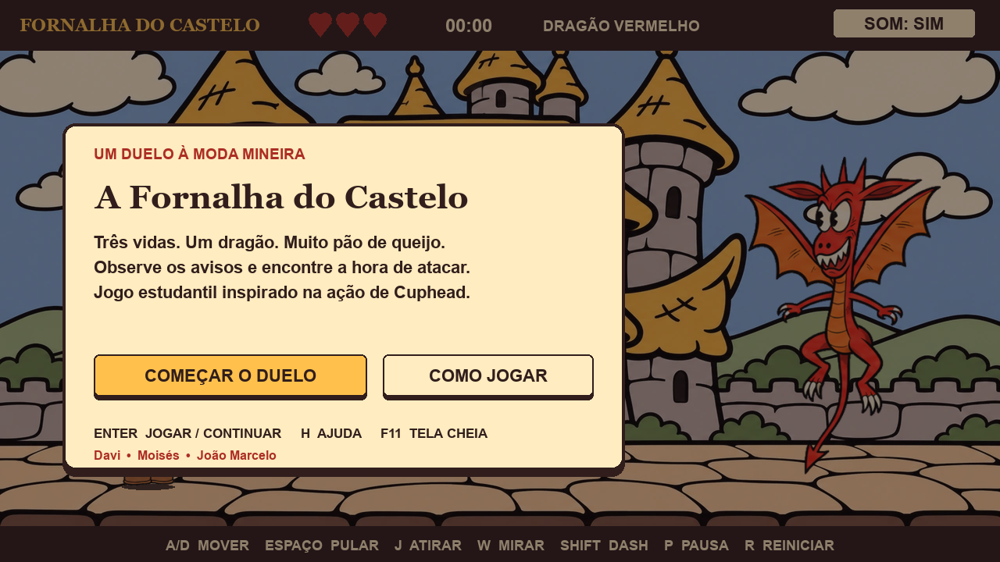

# A Fornalha do Castelo — versão próxima da aula

Jogo de ação lateral em **Python + Pygame**, inspirado em **Cuphead**. O protagonista mineiro atira pães de queijo e precisa derrotar as duas formas do Dragão Vermelho.

**Integrantes:** Davi, Moisés e João Marcelo.  
**Repositório:** [Cuphead-Mineirinho-](https://github.com/barrosojoaomarcelo-coder/Cuphead-Mineirinho-).

## Como executar

Use **Python 3.12**, versão usada nos testes locais. Extraia o ZIP inteiro e abra o terminal na pasta que contém main.py:

~~~sh
python -m pip install -r requirements.txt
python main.py
~~~

No Windows, também é possível abrir **INICIAR_WINDOWS.bat**. O iniciador cria .venv e instala o Pygame. É necessário ter Python instalado e internet na primeira instalação. Se o comando do seu computador for python3, substitua python por python3.

## Controles

| Ação | Teclas |
| --- | --- |
| Mover | A / D ou setas |
| Pular | Espaço ou Z; segure para um salto mais alto |
| Atirar | J ou X; pode segurar |
| Mirar para cima | W ou seta para cima |
| Mirar na diagonal | Combine a mira para cima com A / D |
| Agachar | S ou seta para baixo |
| Dash / esquiva | Shift ou K |
| Pausa / continuar | P ou Esc |
| Reiniciar | R |
| Som | M ou botão no topo |
| Começar / tentar novamente | Enter ou botão no menu |
| Ajuda | H ou botão Como jogar |
| Tela cheia | F11 |
| Sair | Fechar a janela; Esc no menu inicial ou nas telas finais |

A partida pausa ao perder o foco da janela ou abrir a ajuda durante a luta.

## O jogo preservado

- Três vidas e proteção temporária após receber dano.
- Movimento, pulo de altura variável, tiro contínuo, mira e dash.
- Um chefe com duas formas, quatro níveis de ataque e transição dia/noite.
- Nove padrões: bola gigante, sopro, leque, mira fixa, rajada, alturas alternadas, onda, quique e chuva.
- Avisos antecipados, animações, partículas, som e trilha.
- Menu, instruções, pausa, derrota, vitória, reinício, redimensionamento e tela cheia.
- Recorde e preferência de som salvos na pasta de dados do usuário.

Os chefes II e III continuam fora do escopo. Não há modo multijogador ou controles de toque. A vida do chefe fica interna; as mudanças de forma indicam o progresso.

## Como o código se aproxima da aula

A referência é o [handout de Pygame do professor](https://insper.github.io/DesignDeSoftware/pygame/handout/).

- pygame.init(), Clock.tick(FPS) e um loop explícito em main.py.
- load_assets() carrega imagens e sons uma vez.
- Player, Boss, Bread, Fire e Flame herdam de pygame.sprite.Sprite.
- Os objetos têm image, rect e update; kill remove projéteis que saíram da arena.
- Os grupos usam update(), draw(), spritecollide() e groupcollide().
- As colisões usam pygame.Rect. O sopro usa Rect.clipline, explicado no guia.
- Os sons são WAV carregados por pygame.mixer.Sound; não são sintetizados durante o jogo.
- Constantes simples, funções nomeadas, listas, dicionários e if/elif explícitos.

Foram retirados dataclass, a função de ligação da posição do tiro, a fila interna de eventos e a subdivisão do tempo de simulação. Veja [a comparação com a aula](docs/GUIA_DA_AULA.md).

## Divisão da equipe

| Integrante | Responsabilidade | Arquivos |
| --- | --- | --- |
| Moisés | Movimento, colisões, ataques e dificuldade | config.py, sprites.py, engine.py, attacks.py |
| Davi | Carregamento, animações, desenho e áudio | assets.py, scene.py, audio.py, assets/ |
| João Marcelo | Janela, teclado, menus, instalação e integração | main.py, requirements.txt, INICIAR_WINDOWS.bat, documentação e .github/ |

Essa divisão indica as responsabilidades sobre a base adaptada com IA. Cada integrante deve realizar e registrar suas próprias contribuições. Consulte [o plano até segunda-feira](docs/DIVISAO_E_PRAZOS.md) e [as instruções de Git](CONTRIBUTING.md).

## Testar

~~~sh
python -m unittest discover -s tests -v
~~~

Os testes usam dispositivos virtuais do SDL para não abrir janelas. O Pygame precisa estar instalado. Os detalhes e limites da verificação estão em [VALIDACAO.md](docs/VALIDACAO.md).

Para testar apenas a abertura e salvar uma imagem:

~~~sh
python main.py --frames 5 --screenshot abertura.png
~~~

## Vídeo de apresentação

**Pendente:** o grupo deve gravar a versão final funcionando, publicar o vídeo e incluir aqui o link acessível ao professor.

## Créditos e IA

Referência criativa: **Cuphead**, da Studio MDHR — [site oficial](https://cupheadgame.com/). A inspiração está no combate contra chefes, nos tiros, nas esquivas e na apresentação cartunesca.

As artes vieram do ZIP fornecido pelo grupo. A origem de cada recurso deve ser confirmada em [CREDITOS.md](CREDITOS.md).

Esta base foi adaptada e simplificada com auxílio de Codex/ChatGPT. A equipe deve compreender o código, declarar o uso de IA e anexar o histórico conforme as orientações da disciplina. Veja [USO_DE_IA.md](USO_DE_IA.md).
